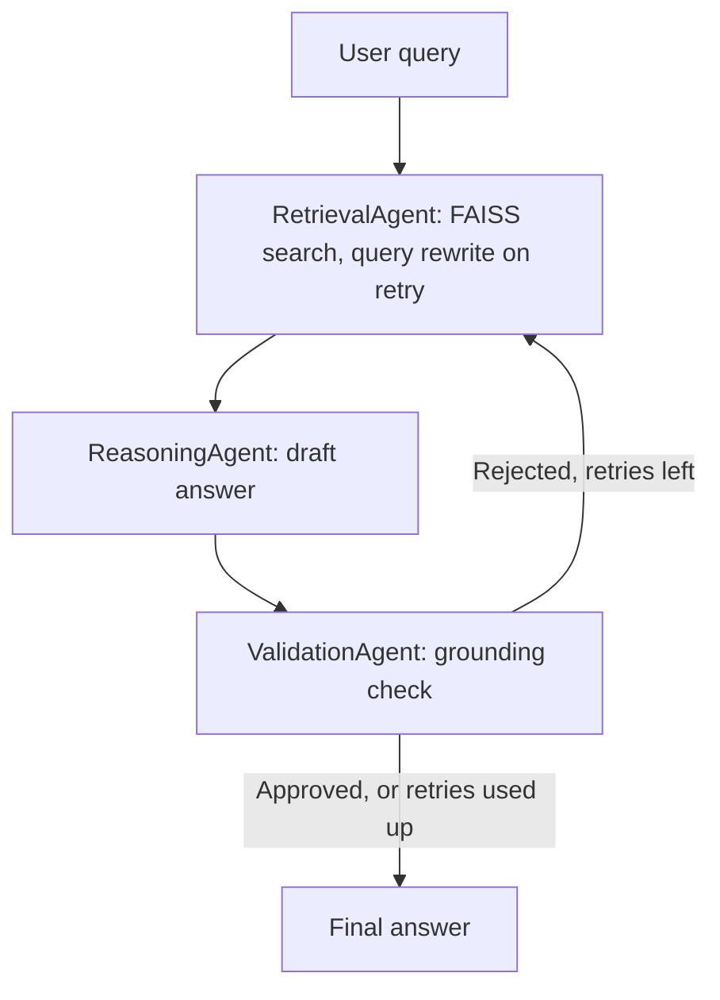

# Agentic Research System

A retrieval-augmented generation (RAG) workspace. A LangGraph graph runs three agents over a local FAISS index: retrieval, reasoning, and validation. When validation rejects a draft, the graph rewrites the query and retrieves again. A FastAPI backend serves the graph, and a React (Vite) frontend shows each agent step as it runs.

**Result:** on 50 questions over 20 RAG and agent papers, the validation loop did not change faithfulness (0.937 without it, 0.946 with up to 2 revisions, 0.937 with up to 4; every paired 95% interval includes zero) and raised p95 latency 3.9× to 7.6×. The bottleneck is retrieval, not validation: the passage that answers the question was in the top 4 retrieved chunks for 20 of 40 answerable questions. Details in [Evaluation](#evaluation) and [docs/benchmarks.md](docs/benchmarks.md).

---

## How it works

* **RetrievalAgent** (`backend/core/agents.py`) searches the FAISS index. On a retry it asks the LLM to rewrite the query using the validator's feedback.
* **ReasoningAgent** writes a draft answer from the retrieved chunks.
* **ValidationAgent** asks the LLM whether each claim in the draft is supported by the chunks, and approves or rejects the draft.
* **Routing** (`backend/core/agent_graph.py`): a rejected draft goes back to retrieval, up to `MAX_RETRIES` times (default 3). An approved draft ends the run.
* **Evaluation** (`backend/core/evaluation.py`) scores faithfulness, answer relevance, and context precision with an LLM-judge prompt modelled on the RAGAS definitions. It does not use the `ragas` library.



---

## Getting started

### Prerequisites
* Python 3.10+
* Node.js 18+

### Backend
1. Create a virtual environment and install dependencies:
   ```bash
   cd backend
   python3 -m venv venv
   source venv/bin/activate
   pip install -r requirements.txt
   ```
2. The backend starts in mock mode (`MOCK_MODE=True`). To call a real model, set these in `backend/.env` or the environment:
   ```bash
   MOCK_MODE=false
   OPENAI_API_KEY=...          # or ANTHROPIC_API_KEY with DEFAULT_LLM_PROVIDER=anthropic
   ```
3. Run from the project root so the imports resolve:
   ```bash
   cd ..
   python3 -m backend.main
   ```
   The API listens on `http://localhost:8000`.

### Frontend
```bash
cd frontend
npm install
npm run dev
```
The dashboard runs on `http://localhost:5173`.

---

## Evaluation

Three configurations answer the same 50 questions: (a) retrieval and reasoning only, (b) the full pipeline with up to 2 revisions, and (c) the full pipeline with up to 4. Forty questions are answerable from a corpus of 20 arXiv papers; ten are not, and the right behaviour is to say so. The pipeline runs gpt-4o-mini at temperature 0.2. The `ragas` library (0.4.3) scores faithfulness, answer relevancy, and context precision with gpt-4o as the judge.

| | a: no validation | b: max 2 revisions | c: max 4 revisions |
|---|---|---|---|
| Faithfulness | 0.937 | 0.946 | 0.937 |
| Refusal accuracy (unanswerable) | 10/10 | 10/10 | 10/10 |
| False refusals (answerable) | 7/40 | 7/40 | 6/40 |
| Latency p50 / p95 | 1.87 / 2.76 s | 4.18 / 10.71 s | 4.21 / 20.98 s |

What the runs show:

* **The loop only ran on refusals.** In b, the 17 answers that ended rejected were exactly the 17 that said the context was insufficient, and the other 33 were approved on the first pass. In c, 33 were again approved on the first pass, 16 refusals were rejected until the limit, and one (q16) was approved after one revision. Apart from q16, every question that ended with a substantive answer got it without a single revision. (Result files keep final answers only, not intermediate drafts.)
* **Revising rarely fixes a refusal.** Configuration c recovered 1 of the 7 answerable questions that a and b refused.
* **Retrieval misses the answer half the time.** The cited paper was retrieved for 39 to 40 of 40 answerable questions, but the cited passage for only 20. In 6 of the 7 false refusals, the answering passage was not retrieved, and rewriting the query on a retry did not change that.

Reproduce (about $4 in OpenAI usage for all three configurations):

```bash
python3 -m venv .venv && .venv/bin/pip install -r eval/requirements.txt
.venv/bin/python eval/corpus.py            # download the corpus and verify hashes
.venv/bin/python eval/check_questions.py   # check every source passage against its paper
.venv/bin/python eval/run_eval.py --config all
.venv/bin/python eval/summarize.py         # rebuild docs/benchmarks.md
```

Runs on 2026-10-27, macOS 26.5.1 on Apple silicon (arm64), Python 3.12.4. The question set was drafted with Claude Code and checked against its sources by `eval/check_questions.py`, not reviewed row by row by hand.

---

## Simulated demo (no LLM calls)

The GitHub Pages site at [zura16.github.io/Agentic-Research-System](https://zura16.github.io/Agentic-Research-System) has no backend. When the frontend cannot reach the API, it switches to a simulator in `frontend/src/App.jsx`. The simulator matches keywords in the query (for example "rag", "agent", "hallucination", "evaluation") and plays back a scripted answer, a scripted trace, and fixed scores. **No model produces these answers**, and the scores are not measurements. The page shows a "Simulated demo" banner while this mode is active.

The backend's own mock mode is also scripted. With `MOCK_MODE=True`, the validator always rejects the first draft and approves the second, and it reports fixed scores (faithfulness 0.4, then 0.98).

---

## Limitations

* **A small evaluation.** 50 questions, one run per configuration, one judge model. Differences smaller than the 95% intervals in [docs/benchmarks.md](docs/benchmarks.md) are noise.
* **The app's Evaluation Studio metrics are homemade.** `backend/core/evaluation.py` uses its own judge prompts, not the `ragas` library; the published numbers come from `eval/`, which does use it. When a judge call fails, faithfulness and relevance return 0.85 and context precision counts the chunk as relevant, instead of raising an error. A failed run can look like a good score. In mock mode, faithfulness is word overlap, floored at 0.5.
* **Mock mode is the default.** Without `MOCK_MODE=false` and an API key, every answer and score comes from scripted code.
* **One local index.** FAISS runs in-process on one machine. There is no auth, multi-user support, or persistence beyond the local vector store directory.
