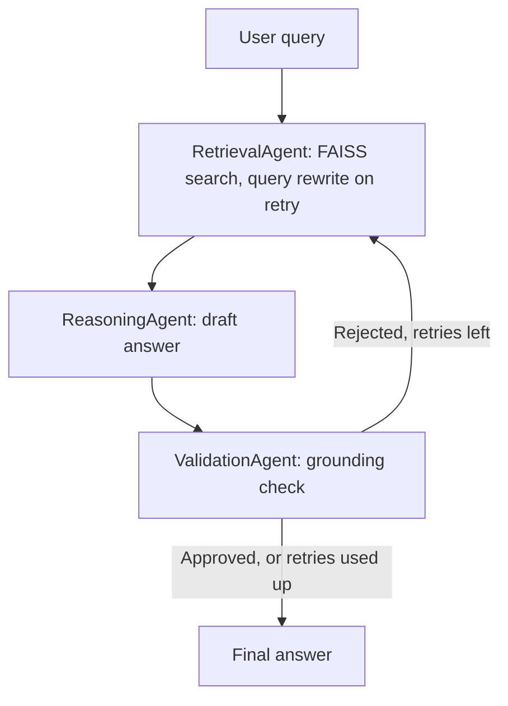

# Agentic Research System

A retrieval-augmented generation (RAG) workspace. A LangGraph graph runs three agents over a local FAISS index: retrieval, reasoning, and validation. When validation rejects a draft, the graph rewrites the query and retrieves again. A FastAPI backend serves the graph, and a React (Vite) frontend shows each agent step as it runs.

No evaluation results are published yet. See [Limitations](#limitations).

---

## How it works

* **RetrievalAgent** (`backend/core/agents.py`) searches the FAISS index. On a retry it asks the LLM to rewrite the query using the validator's feedback.
* **ReasoningAgent** writes a draft answer from the retrieved chunks.
* **ValidationAgent** asks the LLM whether each claim in the draft is supported by the chunks, and approves or rejects the draft.
* **Routing** (`backend/core/agent_graph.py`): a rejected draft goes back to retrieval, up to `MAX_RETRIES` times (default 3). An approved draft ends the run.
* **Evaluation** (`backend/core/evaluation.py`) scores faithfulness, answer relevance, and context precision with an LLM-judge prompt modelled on the RAGAS definitions. It does not use the `ragas` library.



---

## Getting started

### Prerequisites
* Python 3.10+
* Node.js 18+

### Backend
1. Create a virtual environment and install dependencies:
   ```bash
   cd backend
   python3 -m venv venv
   source venv/bin/activate
   pip install -r requirements.txt
   ```
2. The backend starts in mock mode (`MOCK_MODE=True`). To call a real model, set these in `backend/.env` or the environment:
   ```bash
   MOCK_MODE=false
   OPENAI_API_KEY=...          # or ANTHROPIC_API_KEY with DEFAULT_LLM_PROVIDER=anthropic
   ```
3. Run from the project root so the imports resolve:
   ```bash
   cd ..
   python3 -m backend.main
   ```
   The API listens on `http://localhost:8000`.

### Frontend
```bash
cd frontend
npm install
npm run dev
```
The dashboard runs on `http://localhost:5173`.

---

## Simulated demo (no LLM calls)

The GitHub Pages site at [zura16.github.io/Agentic-Research-System](https://zura16.github.io/Agentic-Research-System) has no backend. When the frontend cannot reach the API, it switches to a simulator in `frontend/src/App.jsx`. The simulator matches keywords in the query (for example "rag", "agent", "hallucination", "evaluation") and plays back a scripted answer, a scripted trace, and fixed scores. **No model produces these answers**, and the scores are not measurements. The page shows a "Simulated demo" banner while this mode is active.

The backend's own mock mode is also scripted. With `MOCK_MODE=True`, the validator always rejects the first draft and approves the second, and it reports fixed scores (faithfulness 0.4, then 0.98).

---

## Limitations

* **No measured results.** No benchmark has been run on this pipeline. The repo does not yet show whether the validation loop improves answers.
* **The metrics are homemade.** `evaluation.py` uses its own judge prompts, not the `ragas` library. When a judge call fails, faithfulness and relevance return 0.85 and context precision counts the chunk as relevant, instead of raising an error. A failed run can look like a good score. In mock mode, faithfulness is word overlap, floored at 0.5.
* **Mock mode is the default.** Without `MOCK_MODE=false` and an API key, every answer and score comes from scripted code.
* **One local index.** FAISS runs in-process on one machine. There is no auth, multi-user support, or persistence beyond the local vector store directory.
